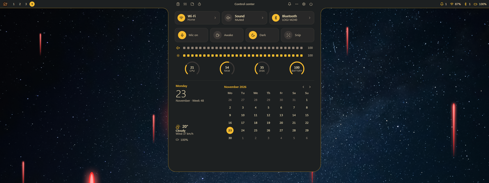
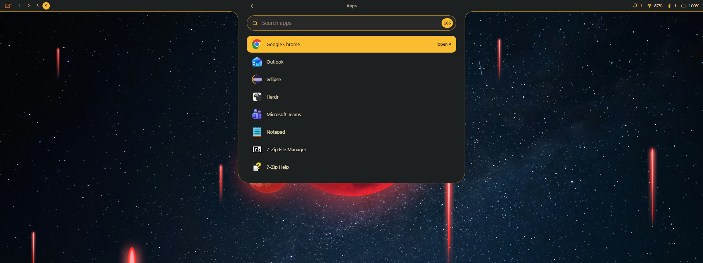

# Kotilo Zebar Pack

A top bar for [GlazeWM](https://github.com/glzr-io/glazewm) with a **dynamic island** in its middle,
built for [Zebar](https://github.com/glzr-io/zebar) 3.1. The island is a small pill that shows what is
going on (media, timers, notifications) and opens into a control centre, an app launcher and a set of
panels — all without leaving the keyboard.





## Features

**Bar**
- GlazeWM workspaces, the tiling direction (click to flip), a button listing every window, and the
  focused window's title.
- Live items on the right: now playing, running timer / Pomodoro / stopwatch, open tasks, notifications
  bell, muted microphone, keep awake, network speed, Wi-Fi signal, Bluetooth and battery. Each one can be
  turned off in Settings.
- The Kotilo logo opens the app launcher.

**Island**
- **Control centre:** Wi-Fi, Sound and Bluetooth tiles; microphone, keep awake, light/dark apps and
  screenshot toggles; volume and brightness; CPU, RAM, disk and battery rings; today's date, weather and
  next calendar event; media controls.
- **Launcher:** one search box for Start menu apps, open windows, system commands (lock, sleep,
  restart…), GlazeWM commands (float, fullscreen, go to or move to a workspace…), Windows Settings pages
  and recent files. Fuzzy matching (`vsc` finds Visual Studio Code); results you pick often rise to the
  top. Prefixes: `=` calculator and unit conversion (`=10 km to mi`, also without `=`), `:` emoji,
  `?` web search, `,` clipboard history.
- **Windows:** every window on every workspace with its program icon; search, switch, close one or all.
- **Panels:** Wi-Fi (join networks), Bluetooth (connect devices), sound devices, system monitor,
  calendar (today and tomorrow, or any day picked in the month, from classic Outlook), clipboard history, system tray, to-do, notes, timer /
  stopwatch / Pomodoro, power menu.
- **Windows notifications:** live banner in the island, a list panel, per-app filter; clicking a
  notification brings that app's existing window to the front.
- **Appearance:** 17 themes (13 dark, 4 light), wallpaper picker, matching GlazeWM window borders.

## Requirements

- Windows 11
- [Zebar](https://github.com/glzr-io/zebar) 3.1.1 or newer
- [GlazeWM](https://github.com/glzr-io/glazewm) 3.x (tested with 3.9.1)
- Optional: classic Outlook running, for calendar events. The new Outlook for Windows has no local
  interface to read events from, so with it the calendar shows the month only.

## Install

1. In Zebar, open the marketplace and install **Kotilo Zebar Pack**
   (or clone this repository into `%USERPROFILE%\.glzr\zebar\kotilo-zebar-pack` and run `npm install && npm run build`).
2. Start the `bar` and `island` widgets with the `default` preset (Zebar tray icon → Widget packs →
   kotilo-zebar-pack). Turn on *Run on startup* for both.
3. Add the GlazeWM settings below and reload GlazeWM (`alt+shift+r`).

### GlazeWM settings

Add these to `%USERPROFILE%\.glzr\glazewm\config.yaml`. They make room for the bar, keep Zebar windows
out of tiling, and add the island's keyboard shortcuts.

```yaml
general:
  startup_commands: ['shell-exec zebar']
  shutdown_commands: ['shell-exec taskkill /IM zebar.exe /F']

gaps:
  outer_gap:
    top: '48px'   # the bar is 40px high

window_rules:
  - commands: ['ignore']
    match:
      - window_process: { equals: 'zebar' }

# Each shortcut turns on a binding mode; the island sees it, opens that panel
# and turns the mode off again. Escape is a fallback if the island is not running.
binding_modes:
  - name: 'island-control'
    keybindings:
      - commands: ['wm-disable-binding-mode --name island-control']
        bindings: ['escape']
  - name: 'island-launcher'
    keybindings:
      - commands: ['wm-disable-binding-mode --name island-launcher']
        bindings: ['escape']
  - name: 'island-power'
    keybindings:
      - commands: ['wm-disable-binding-mode --name island-power']
        bindings: ['escape']
  - name: 'island-timer'
    keybindings:
      - commands: ['wm-disable-binding-mode --name island-timer']
        bindings: ['escape']
  - name: 'island-clipboard'
    keybindings:
      - commands: ['wm-disable-binding-mode --name island-clipboard']
        bindings: ['escape']

keybindings:
  - commands: ['wm-enable-binding-mode --name island-control']
    bindings: ['alt+c']
  - commands: ['wm-enable-binding-mode --name island-launcher']
    bindings: ['alt+e']
  - commands: ['wm-enable-binding-mode --name island-power']
    bindings: ['alt+x']
  - commands: ['wm-enable-binding-mode --name island-timer']
    bindings: ['alt+shift+t']
  - commands: ['wm-enable-binding-mode --name island-clipboard']
    bindings: ['alt+shift+v']
```

Merge these into your existing sections rather than adding the section names twice.

## Shortcuts

| Keys | Opens |
|---|---|
| `Alt+C` | Control centre |
| `Alt+E` | App launcher |
| `Alt+X` | Power menu |
| `Alt+Shift+T` | Timer |
| `Alt+Shift+V` | Clipboard history |
| `Esc` | Closes the island |

## What the pack changes on your system

The island runs small PowerShell helpers from its own `scripts` folder. Zebar only lets it run those
exact files, with no extra arguments (see `privileges` in `zpack.json`). Commands are sent to the
helpers over their standard input and are checked there.

- **Appearance → window borders** writes two colour lines in your GlazeWM `config.yaml`. A backup
  (`config.yaml.bak-appearance`) is made before the first change; choosing the Kotilo theme restores the
  original lines.
- **Appearance → wallpaper** sets the Windows wallpaper from `Pictures\Wallpapers`.
- **Light/dark apps** switches the Windows app theme; **keep awake** blocks sleep while it is on.
- Caches (app icons, wallpaper thumbnails) live in `%LOCALAPPDATA%\kotilo-zebar-pack`.
- The launcher opens only listed Settings pages, Google searches, and recent files through their
  shortcuts in your `Recent` folder. Recent files appear only while Windows' "Show recently opened items"
  setting is on.
- Nothing is sent over the network except the weather lookup Zebar itself makes, and a web search
  when you choose one in the launcher (it opens Google in your browser).

## Known limits

- The helper scripts must live under a user profile path without spaces (`C:\Users\<name>\...`). This is
  a security choice: a space would let another script be slipped into the command line. If your
  Windows user name has a space, the island's panels that use helpers will not work.
- Calendar events need classic Outlook to be running; the island never starts Outlook itself. Click a day
  in the month grid to see that day's events.
- Some apps set a different window ID than their notifications use (for example Firefox); clicking their
  notifications starts the app instead of focusing its window.

## Development

```powershell
npm install
npm run build          # type-check and build into dist/
python -I tools/dev/test_privileges.py zpack.json   # check the shell privilege rules
```

Restart Zebar after changing `zpack.json`. Developer notes (in Turkish) are in `docs/`.

## License

[MIT](LICENSE) © 2026 Kotilo
